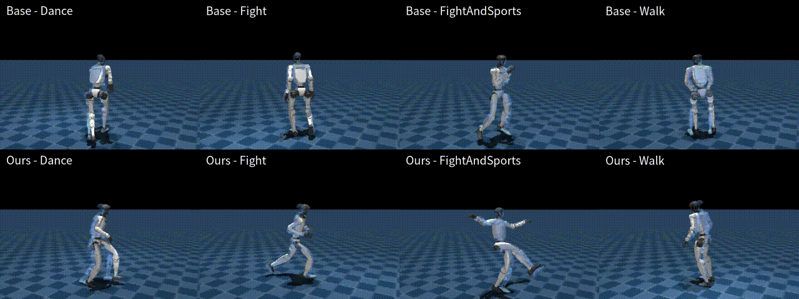

# ForgetMimic: Motion Unlearning for Reinforcement Learning Humanoid Control

**Selective forgetting of specific motions from a trained humanoid control policy.**

This repository is an unlearning framework. Given a trained policy that can perform multiple motions (walk, run, fight, dance, flips, etc.), our method selectively removes specific target motions while preserving all other motions.




## News

[2026.10.28] Source code is uploaded.

[2026.9.24] The preprint is now on arXiv. 

[2026.9.19] Our work is done! The code will be made open source soon.


## Installation

### Prerequisites

- Python 3.10–3.13
- NVIDIA GPU with CUDA 12.8 support (for training)
- [uv](https://docs.astral.sh/uv/) package manager

### Setup

```bash
# Clone the repository
git clone <your-repo-url> && cd forgetmimic

# Install dependencies (CUDA version)
make sync

# Or CPU-only version
make sync-cpu

# Verify installation
uv run wbc-mjlab-list-envs
```

### Convert Motion Data

```bash
uv run wbc-mjlab-data-to-npz --robot g1 --dataset samples --batch-size 8
```

### Available CLI Commands


| Command                 | Description                           |
| ----------------------- | ------------------------------------- |
| `wbc-mjlab-list-envs`   | List available environments           |
| `wbc-mjlab-train`       | Train a WBC policy                    |
| `wbc-mjlab-play`        | Evaluate / play with a trained policy |
| `wbc-mjlab-demo`        | Run a quick demo                      |
| `wbc-mjlab-data-to-npz` | Convert motion data (CSV → NPZ)      |
| `wbc-mjlab-data-vis`    | Visualize motion data                 |
| `forgetmimic`           | Run motion unlearning                 |

## Quick Start

### Training

**Train** on converted npz library (check mjlab train args for resuming, number of envs etc):

```bash
uv run wbc-mjlab-train --task Wbc-G1 --dataset samples
```

**Evaluation** of last exported log on library (check args for viewer, choosing chekpoint, motion etc):

```bash
uv run wbc-mjlab-play --task Wbc-G1 --dataset samples
```

### Unlearn Fight Motions

```bash
uv run forgetmimic \
  --task Wbc-G1 --dataset samples \
  --unlearn-clips fight1_subject2,fightAndSports1_subject1 \
  --checkpoint-file checkpoints/base_model.pt \
  --penalty-weight 8.0
```

### Evaluate Results

```bash
uv run python scripts/eval_unlearning.py
```

### Available Motion Clips


| Clip Name                  | Motion Type          |
| -------------------------- | -------------------- |
| `dance1_subject1`          | Dance                |
| `fallAndGetUp1_subject1`   | Fall & Get Up        |
| `fight1_subject2`          | Fight ️             |
| `fightAndSports1_subject1` | Fight & Sports       |
| `flip_090_001__A304`       | Flip 90°            |
| `flip_090_002__A304`       | Flip 90°            |
| `flip_090_003__A304_M`     | Flip 90° (mirrored) |
| `flip_360_009__A416`       | Flip 360°           |
| `flip_360_011__A416`       | Flip 360°           |
| `run1_subject2`            | Run                  |
| `sprint1_subject2`         | Sprint               |
| `walk1_subject1`           | Walk                 |


### Cite
If you use our code in your work, please cite [our paper](https://arxiv.org/abs/2609.28378):
```bibtex
@misc{luan2026forgetmimicmotionunlearningreinforcement,
      title={ForgetMimic: Motion Unlearning for Reinforcement Learning Humanoid Control}, 
      author={Xukun Luan and Zhongxiang Lei and Chen Gong and Shaowei Li and Yuanguo Bi and Jinyan Liu},
      year={2026},
      eprint={2609.28378},
      archivePrefix={arXiv},
      primaryClass={cs.RO},
      url={https://arxiv.org/abs/2609.28378}, 
}
```


## Acknowledgment

We are grateful for the open-source efforts of [WBC-Mjlab](https://github.com/wbc-mjlab/wbc-mjlab) and [Mjlab](https://github.com/mujocolab/mjlab).
